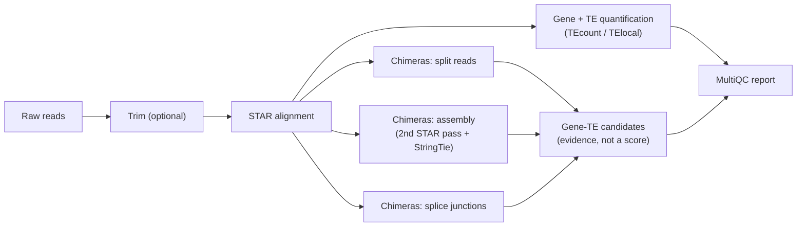

# TEpipe


*Formerly TEtranscripts-pipe.*

**TEpipe finds TE-gene chimeras in RNA-seq.** One Snakemake run takes FASTQ
files to gene + transposable element (TE) counts
([TEcount](https://github.com/mhammell-laboratory/TEtranscripts) per family,
TElocal per copy) and to gene-TE chimeric transcripts from three independent
screens, all summarised in one MultiQC report.



*(Simplified: every rule and optional stage is in the
[full pipeline flowchart](https://github.com/altintasali/TEpipe/wiki/Full-Pipeline-Flowchart).)*

## What you get

| Output | Use it for |
|---|---|
| `results/tecount/`, `results/telocal/` (per-sample tables + `counts_matrix.tsv.gz`) | gene + TE counts per family (TEcount) and per copy (TElocal), for your own DESeq2/edgeR |
| `results/chimera/candidates.tsv.gz` + `candidates_explorer.html` | every gene-TE pair with all evidence from all screens; the HTML is a searchable, sortable table |
| `results/chimera/{assembly,splice_junctions}/gene_te_chimera_counts_matrix.tsv.gz` | chimera counts per sample, for differential chimera usage |
| `results/qc/multiqc_report.html` | QC, alignment, strandedness, sample PCA/clustering, chimera summaries, tool versions |

TEpipe does **not** run differential expression and does **not** score or rank
chimeras: candidates are evidence to sort, filter and check by eye.

### The three chimera screens

| Screen | Tool | Catches | Misses |
|---|---|---|---|
| Split reads (`chimera.chimeric_reads`) | STAR chimeric output | a read split between a gene and a TE; needs no annotation | chimeras spliced through a normal intron |
| Assembly (`chimera.assembly`) | StringTie on its own STAR pass | whole transcripts: where the TE sits | transcripts with too few reads |
| Splice junctions (`chimera.splice_junctions`) | STAR `SJ.out.tab` | exact TE-exon joins; GT...AG gives the strand | the rest of the transcript |

Each pair is labelled **novel** (`te_initiated`, `te_exonized`, `te_terminated`),
**annotated** (already in the GTF) or **antisense**. How the screens work and
how to read their output: [Chimera Detection](https://github.com/altintasali/TEpipe/wiki/Chimera-Detection)
and [Interpreting Your Results](https://github.com/altintasali/TEpipe/wiki/Interpreting-Your-Results).

## Install

Pre-built environment (recommended; Linux x86_64, needs only `bash`/`curl`/`tar`):

```bash
git clone https://github.com/altintasali/TEpipe.git && cd TEpipe
./workflow/scripts/install-env.sh          # latest release into ~/software/tepipe-env
source workflow/scripts/activate-env.sh
```

Or with conda: `conda env create -f workflow/environment.yaml && conda activate tepipe`.
Custom install paths, pinned releases and upgrading: [Installation](https://github.com/altintasali/TEpipe/wiki/Installation).

## Quick start

```bash
snakemake --configfile config/test.yaml -n           # dry run: prints the plan
snakemake --configfile config/test.yaml --cores 4    # tiny bundled test dataset

cp config/config.example.yaml input/config.yaml      # your analysis
cp config/samples.example.csv input/samples.csv      # (input/ is gitignored)
# edit both: reference paths in config.yaml, one row per sample in samples.csv
snakemake --cores 16
```

The sample sheet has `sample`, `fastq_1`, `fastq_2`, `strandedness` and
`condition` columns; an nf-core/rnaseq sample sheet works as-is.

## Examples

**From a folder of FASTQs, in one command.** The `tepipe` CLI writes the config
and sample sheet for you, then runs snakemake:

```bash
workflow/scripts/tepipe run --fasta genome.fa.gz --gtf genes.gtf.gz \
    --te-gtf te.gtf.gz --reads fastq/ --cores 16
```

**On a SLURM cluster.** Each rule runs as its own job
([HPC and SLURM](https://github.com/altintasali/TEpipe/wiki/HPC-and-SLURM)):

```bash
workflow/scripts/tepipe run --config input/config.yaml --profile workflow/profiles/slurm
```

**TE quantification only.** In `input/config.yaml`, set `enabled: false`
under all three screens: `chimera.chimeric_reads`, `chimera.assembly` and
`chimera.splice_junctions`.

**Faster chimera screen.** The assembly screen costs a second STAR pass
(about twice the alignment time and peak disk). It pays off on well-annotated
genomes such as human and mouse. On poorly annotated TEs, or to save time, set
`chimera.assembly.enabled: false` and keep the other two screens.

## Documentation

Everything else is in the **[wiki](https://github.com/altintasali/TEpipe/wiki)**:

- **Running:** [Installation](https://github.com/altintasali/TEpipe/wiki/Installation) · [Configuration Reference](https://github.com/altintasali/TEpipe/wiki/Configuration-Reference) · [Command-Line Interface](https://github.com/altintasali/TEpipe/wiki/Command-Line-Interface) · [Running the Pipeline](https://github.com/altintasali/TEpipe/wiki/Running-the-Pipeline) · [HPC and SLURM](https://github.com/altintasali/TEpipe/wiki/HPC-and-SLURM) · [Resource Usage and Reports](https://github.com/altintasali/TEpipe/wiki/Resource-Usage-and-Reports)
- **How it works:** [Strandedness and STAR 2-pass](https://github.com/altintasali/TEpipe/wiki/Strandedness-and-STAR-2-pass) · [TEcounts Sample-QC](https://github.com/altintasali/TEpipe/wiki/TEcounts-Sample-QC) · [TElocal](https://github.com/altintasali/TEpipe/wiki/TElocal) · [Chimera Detection](https://github.com/altintasali/TEpipe/wiki/Chimera-Detection)
- **Results:** [Interpreting Your Results](https://github.com/altintasali/TEpipe/wiki/Interpreting-Your-Results) · [Output Layout](https://github.com/altintasali/TEpipe/wiki/Output-Layout) · [Chimera evidence measurements](docs/chimera-evidence.md) (what has been measured about each signal, and what hasn't)

## Notes

- Memory: STAR indexing and TEtranscripts are memory-hungry (TEtranscripts: about 20-30 GB for human).
- Gzipped FASTQs and references (`.fa.gz`, `.gtf.gz`) work directly.
- A finished run directory can be moved or renamed without triggering reruns.
